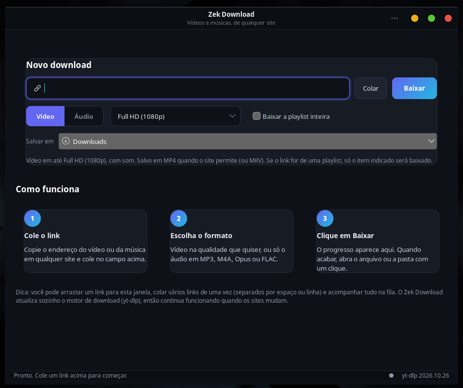

# Zek Download (Windows)

Baixe **vídeos e músicas** de milhares de sites. Mesma interface e funções da versão Linux, escrito em **Rust**.
Usa o [yt-dlp](https://github.com/yt-dlp/yt-dlp) como motor e **se mantém atualizado sozinho**.

## Prévia

## Duas formas de usar
- **Instalador:** `ZekDownload-Setup-x.y.z.exe` — instala só para você (sem administrador), com atalhos.
- **Portátil:** `ZekDownload-Portable-x.y.z.zip` — extraia onde quiser e abra `zek-download.exe`.
  Configurações e motor ficam na pasta `data` ao lado do programa (pendrive-friendly).

Na primeira vez o app baixa sozinho o yt-dlp, o ffmpeg e o interpretador do YouTube (precisa de internet;
o ffmpeg tem ~100 MB). Depois disso ele só atualiza o que for preciso.

## Como usar
1. **Cole o link** (ao abrir o app, se houver um link copiado ele já aparece no campo).
2. Escolha **Vídeo** (qualidade) ou **Áudio** (MP3, M4A, Opus, FLAC).
3. Clique em **Baixar** e acompanhe porcentagem, velocidade e tempo restante.

## Como ele se adapta quando o yt-dlp muda
Não embute o yt-dlp: baixa o oficial, confere o SHA-256 e atualiza ao abrir (a cada 6 h) ou pelo **Menu**.
Se um download falhar com sinais de "site mudou", atualiza o motor e **tenta de novo sozinho**.
Canal **Nightly** em Configurações recebe correções antes.

## Compilar (GitHub Actions)
O build roda sozinho no GitHub a cada `push` na `main`:
1. Aba **Actions → Build Windows → Run workflow** (ou faça um push).
2. Ao terminar, baixe o artefato **ZekDownload-Windows** (instalador + portátil + `SHA256SUMS.txt`).
3. Para uma release: `git tag v1.1.0 && git push origin v1.1.0` (cria uma release **rascunho** com os arquivos).

Localmente (Windows, com Rust e Inno Setup): `cargo test && cargo build --release`.
O ícone é gerado por `python assets/make_icon.py`.

### ⚠️ Aviso sobre direitos autorais

O Zek Download é uma ferramenta destinada ao download de conteúdos próprios, de domínio público ou cujo download tenha sido expressamente autorizado pelo titular dos direitos.

O usuário é inteiramente responsável pelo uso do programa e deve respeitar as leis de direitos autorais e os termos de serviço das plataformas utilizadas.

**Não utilize o Zek Download para baixar ou distribuir conteúdos protegidos sem a devida autorização.**. Licença: MIT. Veja `SECURITY.md`.
